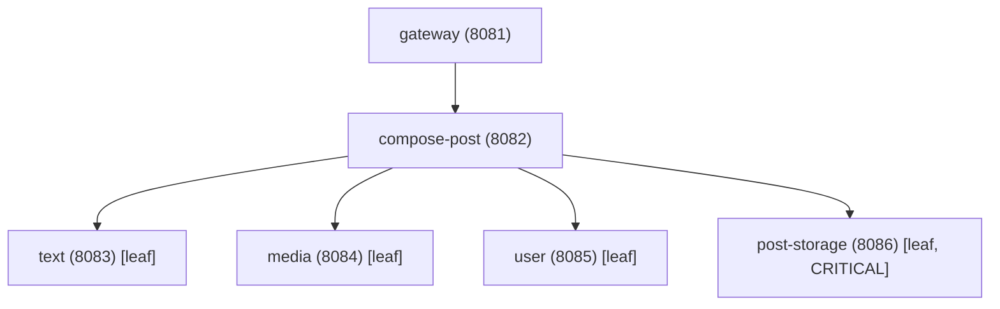

# ARCHITECTURE: Self-Healing Microservices Platform

## 1. System Overview & Novelties
This platform demonstrates automated, closed-loop resilience for microservices running under tight hardware constraints (Windows, 8 GB RAM, no GPU, JVM -Xmx128m). It benchmarks a traditional baseline against three key novel contributions:
- **N1. Link-Level Diagnosis**: Pinpoint faults located directly on service-to-service communication links, distinguishing link degradation from downstream node failure.
- **N2. Fault-Type-Driven Healing**: Node faults trigger process restarts; link faults trigger runtime link policy adjustments (timeouts, retries, circuit breaking) with zero downtime.
- **N3. Recovery-Failure Attribution**: When remediation fails, diagnose the outcome as `WRONG_TARGET`, `INEFFECTIVE_ACTION`, or `INCONCLUSIVE`, updating only the responsible subsystem/policy table.

## 2. Microservice Topology & Ports
A 6-service microservice tree running on Spring Boot 3.x, packaged as a single configurable jar (`service-app.jar`):

### Call Semantics & Dependency Rules
- **Critical Downstream**: `post-storage` (failure triggers request error).
- **Non-Critical Downstream**: `text`, `media`, `user` (fail-fast -> continue with `degraded=true`).
- **Endpoint**: `/work` executes 5–10 ms simulated workload, small CPU burn, delegates downstream via `LinkClient`, returns aggregated JSON.

## 3. Component Architecture

### A. common-lib
- **`EdgePolicy`**: Per outgoing link: `timeoutMs=800`, `maxRetries=2`, `retryBudgetPct=20`, `breakerOpen=false`. Dynamically updated at runtime.
- **`LinkClient`**:
  1. Checks if circuit breaker is open -> fallback.
  2. Queries local/cached Chaos Registry for injected `delayMs` and `lossPct` on the specific directed edge `(caller -> target)`.
  3. Executes HTTP call with policy timeouts and retry budget.
  4. Records `EdgeStats` (calls, errors, latency sum, bytes in/out).
- **Chaos & State Invariant**: Link faults reside in the Healer's Chaos Registry (polled every 1s by services). Node faults (CPU hog, crash) live inside the service process. Restarting a service clears node faults, but does NOT clear link faults.
- **Telemetry**: Exposes `GET /internal/telemetry` every 3s: process/system CPU, heap/committed memory, link stats, and fixed message template counters (`LINK_TIMEOUT`, `DOWNSTREAM_ERROR`).
- **Control Endpoints**:
  - `POST /chaos/cpu?on=true|false`
  - `POST /chaos/crash` (responds then `Runtime.halt(1)`)
  - `PUT /internal/policy/{target}` (runtime `EdgePolicy` update)

### B. Healer Service (Port 8080)
- **ServiceManager**: Starts, monitors, and stops OS processes via `ProcessBuilder`. Tracks uptime and downtime per service.
- **LoadGenerator**: Sends 5–10 req/s to `gateway:8081`. Evaluates SLO health: `p95 < 400ms` AND `error rate < 3%`.
- **Collector**: Polls all service telemetry every 3s. Computes rolling samples (mean of last 3 windows) and compares against a baseline profile established after 2–3 minutes of healthy traffic.
- **Chaos Registry**: REST API (`PUT/DELETE /chaos/link`) storing active link impairments. Polled by services.
- **Detector**: Opens an incident when SLO is violated or any signal has $z > 4$ for 2 consecutive samples.
- **Persistence**: Embedded H2 file database tracking incidents, actions, attribution outcomes, Q-table, and labelled samples.
- **Dual Operating Modes**:
  - **BASELINE**: Attributes fault to highest abnormality service; always restarts that service; verifies after 3 windows; tries next suspect up to 3 attempts.
  - **PROPOSED**: Integrates N1 (Link diagnosis), N2 (Fault-type healing), and N3 (Attribution).
- **DiagnosisClient**: Calls Python FastAPI `/diagnose` (1s timeout) with graceful fallback to built-in Java statistical localizer.

### C. N1: Link-Level Diagnosis
- Joint candidate ranking of both services and links.
- **Disambiguation Logic**: If link $(A \to B)$ is abnormal (high latency or error rate) but $B$'s own node metrics (CPU, internal error logs) are normal $\to$ classify as **LINK FAULT**. If $B$'s own signals are abnormal $\to$ blame node $B$.
- *Note*: Statistical link detector (approximation clearly marked in docs and UI).

### D. N2: Fault-Type-Driven Healing
- Fault classification:
  - High CPU $\to$ `cpu_hog`
  - Error logs / unreachable $\to$ `crash`
  - High link latency $\to$ `link_delay`
  - High link error rate $\to$ `link_loss`
- Action dispatch:
  - Node faults (`cpu_hog`, `crash`) $\to$ Process Restart.
  - Link faults (`link_delay`, `link_loss`) $\to$ Link policy adjustment via `PUT /internal/policy/{target}` (lower timeout, zero retries, fallback, or open circuit breaker; 0 downtime).
- Policy Matrix $Q[\text{faultType}][\text{action}]$ in H2 (initial values: 0.9 primary, 0.5 alternative). Update rule: success: $q \leftarrow q + 0.3(1-q)$; failure: $q \leftarrow q \times 0.3$.

### E. N3: Recovery-Failure Attribution & Selective Update
After action, wait 3 evaluation windows. If SLO is still violated:
- Acted on link AND callee node signals $z \ge 4 \to$ `WRONG_TARGET` (suspect callee).
- $z_T \ge 4$ on acted component and no other component $> 1.5 \times z_T \to$ `INEFFECTIVE_ACTION`.
- $z_T < 2.5$ and another component $z \ge 4 \to$ `WRONG_TARGET` (suspect that component).
- Otherwise $\to$ `INCONCLUSIVE`.
- Update discipline: `INEFFECTIVE_ACTION` lowers Q-score for that action on that fault type and retries same target; `WRONG_TARGET` preserves Q-score, records suspect shift, and on eventual recovery saves labelled sample for model training.

### F. Dashboard & UI
- Single-page application served statically by Healer using Design System from `design.md`.
- Real-time updates via Server-Sent Events (`/events`).
- Offline-only vendored libraries: Chart.js and vis-network.
- Views: Topology map, real-time p95 & error rate metrics, incident timeline, chaos injection controls, mode toggle (Baseline vs Proposed), and KPI cards.

### G. Diagnosis Service (Python FastAPI, Port 5000)
- Exposes `POST /diagnose` returning anomaly flag and node probabilities.
- Starts as a statistical z-score stub; later interfaces with MODIFy model.
